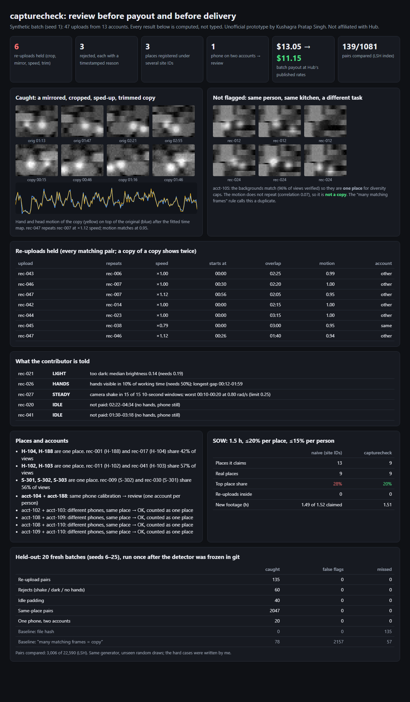

# capturecheck: review contributor recordings before payout and before delivery

Hub pays contributors **"per approved hour"** ($5–9/h) and says **"Hub reviews every recording"**. The bar is "steady first-person view, hands visible, good light, one complete task", and **"if rejected, the reason"** ([ai.hub.xyz/facts](https://ai.hub.xyz/facts)). Client datasets come with **diversity caps** ([hub.xyz](https://hub.xyz)).

At 150,000+ contributors, some problems can't be seen by a reviewer watching one recording:
- the same clip re-uploaded after cropping, mirroring, speeding up or trimming
- one phone on two accounts
- idle time padding a paid hour
- one kitchen registered as three "sites", which quietly breaks a client's diversity cap

`capturecheck` looks across the whole batch before money or data leaves.



## What it does

| Check | How |
|---|---|
| **Re-uploads** | A 64-bit dHash of every frame (and its mirror) goes into a bit-sampling LSH index, so only plausible pairs are compared (3,006 of 22,590 pairs on held-out). A pair is a copy only if its **hand and head motion repeats along one straight time map**. The map is fitted chunk by chunk with Theil–Sen over any speed (0.75–1.33×) and offset. Overlapping seconds aren't paid twice. |
| **Same room ≠ same footage** | Two different tasks in one kitchen share background frames. That makes them **one place** (for caps), **not a copy** (motion doesn't repeat). |
| **Places** | A view counts as the same place only if the hash is close **and** 12×16 thumbnails correlate ≥ 0.9. Average-linkage clustering means one lucky match can't chain look-alike rooms together. Site IDs that turn out to be one place are listed with evidence. |
| **Accounts** | The camera/IMU calibration the capture app already stores (VIO needs it) is compared across accounts. One phone on two accounts goes to a person's **review**. Different phones in one place (household, coworkers) are OK and counted as one place. |
| **Quality** | STEADY (high-passed gyro RMS per 10 s window), LIGHT (median brightness), HANDS (hand-keypoint confidence). Each reject carries a reason with timestamps. |
| **Idle** | 15 s or more with no hands **and** a still phone isn't paid. Short pauses are paid. |
| **SOW manifest** | One greedy picker runs twice: on claimed site IDs (naive) and on detected places and linked accounts. |

## Results (all data synthetic)

**Held-out:** 20 batches (seeds 6–25) generated after the detector was committed in git, run once:

| | caught | false flags | missed |
|---|---|---|---|
| Re-upload pairs (reencode / crop / mirror / speed / trim / all at once) | 135 | 0 | 0 |
| Rejects (shake / dark / no hands) | 60 | 0 | 0 |
| Idle padding | 40 | 0 | 0 |
| Same-place recording pairs | 2,047 | 0 | 0 |
| Look-alike rooms merged | – | 0 | – |
| One phone, two accounts | 20 | 0 | 0 |
| *Baseline: file hash* | *0* | *0* | *135* |
| *Baseline: "many matching frames = copy"* | *78* | ***2,157*** | *57* |

The naive frame rule fails both ways: it flags honest same-kitchen work (2,157 pairs) and misses mirrored or cropped copies.

**Demo batch (seed 1):**
- 6 re-uploads held
- 3 rejects with reasons
- 2 recordings paid only for active time
- 3 places registered under several site IDs
- 1 phone on two accounts
- The naive SOW manifest "has" 13 places but really 9, with the top place at 28% against a 20% cap. The checked one keeps the top place at 20%.

**Payout** at Hub's published rates: $13.05 → $11.15 on the demo batch. That's driven by how many copies I planted, so treat it as the mechanism, not a forecast.

## Run

```bash
pip install numpy pytest
python demo.py                      # → out/report.html, out/report.json
python -m pytest -q                 # 7 tests; python evaluate_seeds.py heldout re-runs the table
```

## Honest limits

- Recordings are **synthetic**: 24×32 grayscale thumbnails of procedurally generated rooms with hand blobs, a simulated gyro and calibration. Real video needs a production perceptual hash (e.g. Meta's open-source PDQ / TMK+PDQF) and real hand keypoints. The pipeline shape stays the same.
- Held-out batches come from **the same generator** with unseen random draws. I wrote the hard cases (static camera, household, look-alike room, copy of a copy). Real fraud will try things I didn't plant.
- One viewing spot per room. A room filmed from opposite walls would split into two places.
- Calibration matching assumes the stored calibration repeats on a phone. Temperature drift and recalibration need measuring on real devices. Device signals are fingerprints ([SensorID, IEEE S&P 2019](https://www.ieee-security.org/TC/SP2019/papers/405.pdf)), so here they only open a review and never ship in a dataset.
- Task completion ("one complete task") isn't checked.
- Nothing here touches Hub's systems or data.

Unofficial prototype by Kushagra Pratap Singh. Not affiliated with Hub.
